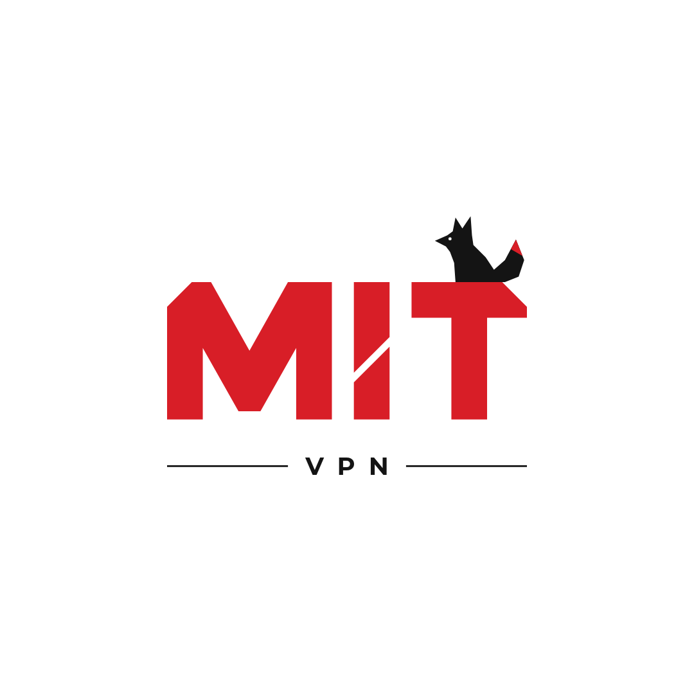

<div align="center">
  

  # MIT Panel

  **A multi-panel admin manager**
</div>

---

MIT Panel is a self-hosted dashboard to manage your VPN panels from one place. It supports **Marzban**, **3x-ui**, **Tx-ui** and **Guard** (S-ui coming soon), lets you create sub-admins with traffic and expiry limits, monitor usage, customize the login page, and back up the database to Telegram automatically.

---

## Installation

One-line install (recommended):

```bash
curl -fsSL https://raw.githubusercontent.com/liwyd/mit-panel/main/install.sh | sudo bash
```

It installs Docker if needed, downloads the files, builds the panel and sets up the `mit-panel` command.

Manual install:

```bash
git clone https://github.com/liwyd/mit-panel.git
cd mit-panel
cp .env.example .env        # set ADMIN_USERNAME / ADMIN_PASSWORD / JWT_SECRET_KEY / PORT
docker compose up -d --build
```

Then open `http://<your-server>:<PORT>/<URLPATH>/login` (default `URLPATH` is `dashboard`).

---

## Uninstallation

```bash
mit-panel uninstall
```

It asks for confirmation, then removes the containers, the database and the `mit-panel` command.

---

## mit-panel commands

```bash
mit-panel           # Show management menu
mit-panel status    # Show panel status
mit-panel start     # Start the panel
mit-panel stop      # Stop the panel
mit-panel restart   # Restart the panel
mit-panel update    # Update to latest version
mit-panel logs      # View container logs
mit-panel settings  # Show current settings
mit-panel set-username    # Change admin username
mit-panel set-password    # Change admin password
mit-panel set-port        # Change panel port
mit-panel set-urlpath     # Change URL path
mit-panel set-bot-token   # Set Telegram bot token
mit-panel edit-env        # Open .env in editor
mit-panel uninstall       # Remove the panel completely
mit-panel help            # Show help
```

---

## Development guide

Requirements: Python 3.12+, [uv](https://docs.astral.sh/uv/), Node 20+.

```bash
git clone https://github.com/liwyd/mit-panel.git
cd mit-panel
cp .env.example .env
```

Run the backend:

```bash
uv run python main.py
```

Run the frontend (in another terminal):

```bash
cd frontend
npm install
npm run dev
```

Checks before pushing:

```bash
uv run --with pytest pytest -q     # backend tests (--with pytest is required)
npm run lint                       # frontend lint
npm run type-check                 # frontend types
```
